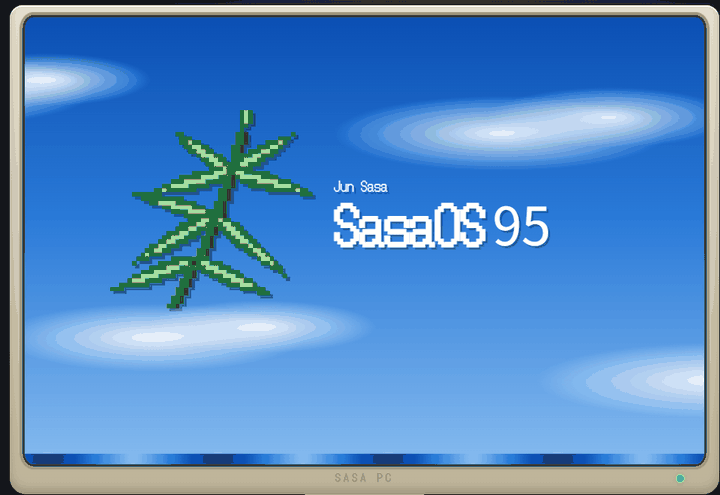

  

  
  
  

### 🙋 About

はじめまして、笹 純です。22歳で、東京の大学で国際経営を学んでいます。
好きなことは、バスケと旅行です。フィリピンとオーストラリアで、1年近く海外に住んでいました。
気になったことはまず試してみる性格で、このページの作品も、そうして作ったものです。

Hi, I'm Jun Sasa, a 22-year-old student studying international business at a university in Tokyo.
I love basketball and traveling, and I lived abroad for nearly a year, in the Philippines and Australia.
I like to try things out as soon as I get curious, and that's how the projects on this page came about.

<table>
<tr><td>🏀 <b>Likes</b></td><td>バスケ、旅行</td></tr>
<tr><td>✈️ <b>Been to</b></td><td><b>16 countries</b>：Australia、Philippines、New Zealand、Vietnam、Thailand、Korea ほか</td></tr>
<tr><td>🔥 <b>Lately</b></td><td>AIを使った個人開発</td></tr>
<tr><td>🗣️ <b>Languages</b></td><td>日本語、English（IELTS 7.0）</td></tr>
<tr><td>🎓 <b>School</b></td><td>立教大学 経営学部 国際経営学科</td></tr>
<tr><td>💼 <b>Now</b></td><td>長期インターンで、マーケティングとシステム開発の両方に関わっています</td></tr>
<tr><td>💬 <b>Motto</b></td><td>まずやってみる</td></tr>
</table>

### 🖥️ Demo

  

ジュン‐ササ辞典：昔のパソコンの画面の中で、辞典を読んだり、ささAIに質問したりできます

### 🛠️ Projects

<table>
<tr>
<td width="50%" valign="top">

**📖 [ジュン‐ササ辞典](https://junsasa.com)** 
自分の経験と考え方を辞典の形にまとめたサイト。AIの「ささAI」が、辞典の中身をもとに質問に答えます（AIの答えであることを常に表示）。

`Cloudflare Workers` `D1` `Claude API` `TypeScript`

</td>
<td width="50%" valign="top">

**📝 [nippou-ai](https://github.com/juns0514555-afk/nippou-ai)**  
PCで開いていたアプリとウィンドウから、AIがその日の日報を書くWindowsツール。Gemini、Claude API、APIキー不要の Claude Code から選べます。

`Python` `Gemini` `Claude API` `Claude Code`

</td>
</tr>
<tr>
<td width="50%" valign="top">

**📊 学習記録アプリのMCPサーバー** 
AIアシスタントとの会話の中で、自分の学習記録を確認したり書き込んだりできる個人用ツール。週ごとの目標との差も出します。

`Python` `MCP`

</td>
<td width="50%" valign="top">

**🎓 大学の授業システムを読むツール** 
課題の締切、お知らせ、授業資料をまとめて読み、講義動画の文字起こしからノートを作る個人用ツール。

`Node.js` `MCP` `faster-whisper`

</td>
</tr>
<tr>
<td width="50%" valign="top">

**💬 公式LINE** 
辞典と同じ見た目のメニューで、質問の受付や辞典への案内を返す窓口。

`LINE Official Account`

</td>
</tr>
</table>

「public」の付いた作品はコードを公開しています。ほかは非公開です。 / Projects marked "public" are open source.

<b>💡 なぜ辞典を作ったのか</b>

 

面接の短い時間では、自分のことを伝えきれないと感じていました。話す側と聞く側の間には、どうしても知っていることの差があります。
そこで、経験や考え方を辞典の形にまとめて、気になるところだけ先に読んでもらえるようにしました。
読むだけでなく、その場で聞きたいことを聞けるように、ささAIを置いています。

<b>🧭 これまでの歩み</b>

 

| | |
|---|---|
| 中学 | バスケ部のキャプテン。けがでプレーできない半年間、チームの評価シートを作って回した |
| 高校 | バスケ部のポイントガード |
| 大学1～2年 | アルバイトで留学資金を貯める |
| 2025 | フィリピンで語学留学 → オーストラリアでワーキングホリデー（メルボルン、ゴールドコースト） |
| 2026 | 帰国。長期インターンで、マーケティングとシステム開発に関わる。ジュン‐ササ辞典を公開 |

### 🧰 Tech

  
  
  
  
  
  

  

